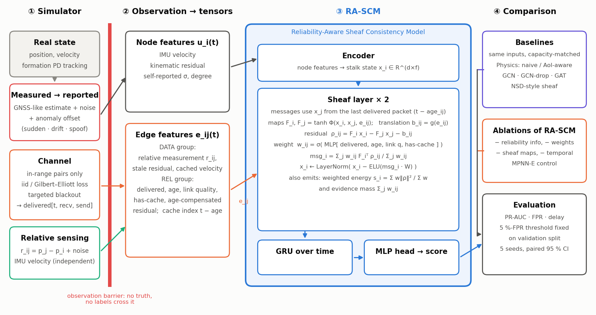
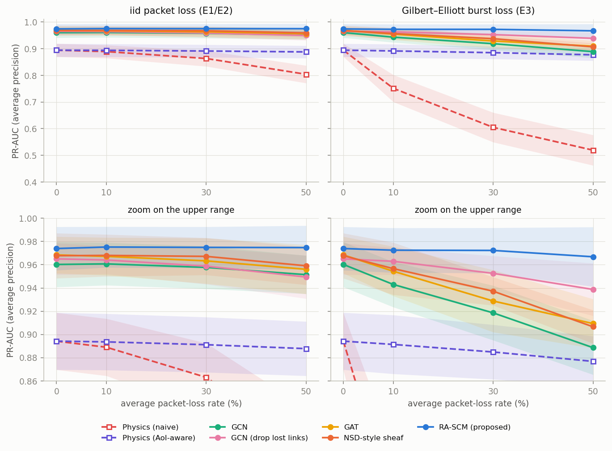
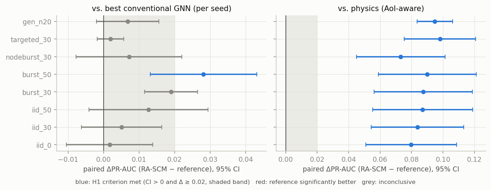
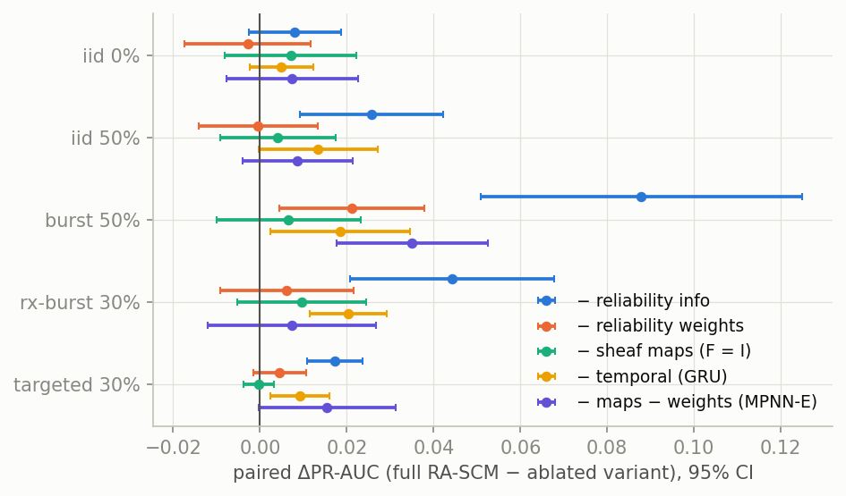
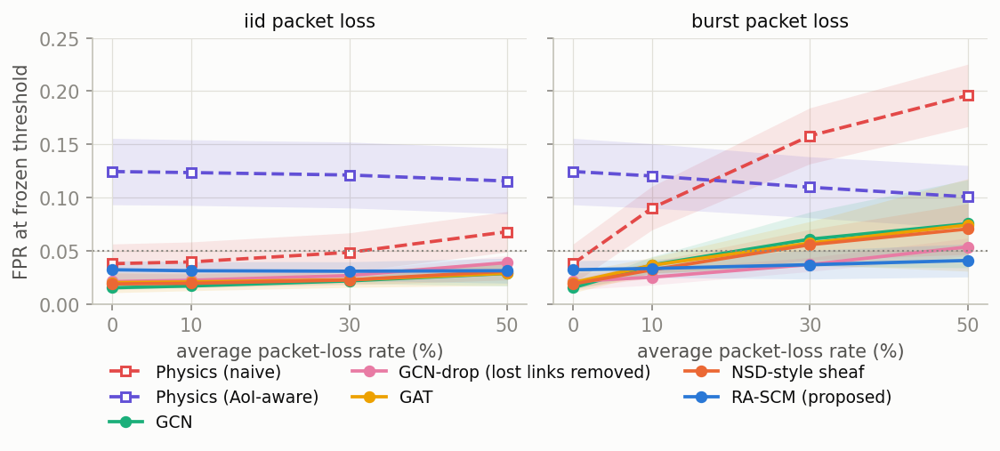
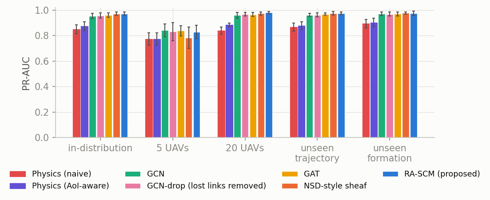
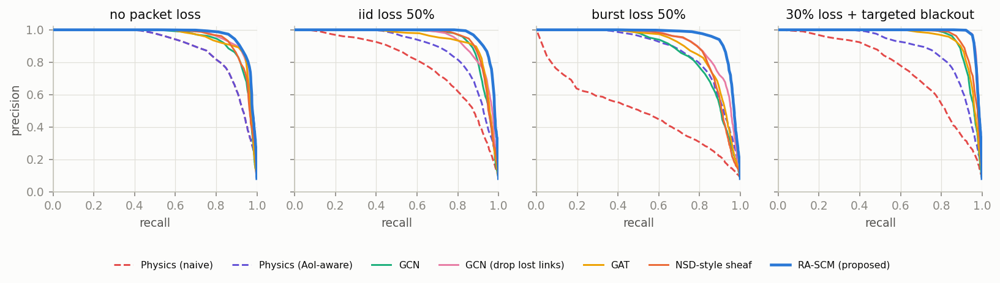
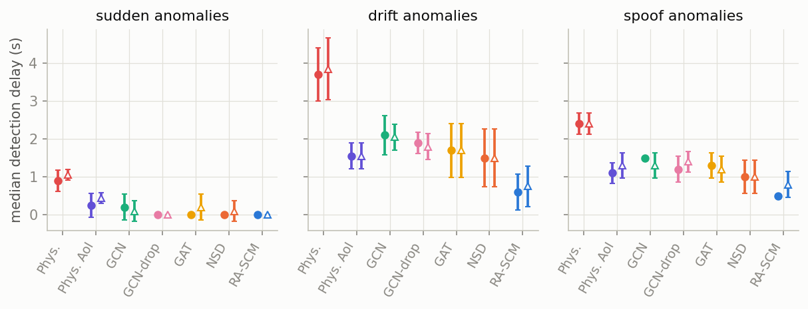
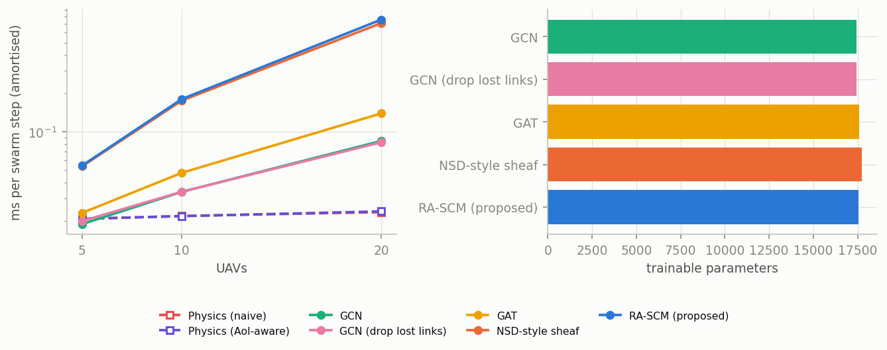

Mehmet Ünlü (040230253) · unlu23@itu.edu.tr · Istanbul Technical University, Electronics and Communication Engineering · EHB 420E Artificial Neural Networks · HW1 – From Curiosity to Scientific Discovery · 30 October 2026

<strong>Abstract.</strong> A UAV swarm must tell a genuinely wrong position report from a merely stale one, because packet loss and localisation faults both create inconsistencies between reported and measured relative positions. In 20 verified sources we found no study that evaluates learned graph or sheaf-based position-anomaly detectors under explicitly modelled loss, burst loss and age of information against an age-aware physical-consistency baseline (search coverage is limited: IEEE Xplore and ACM DL were not queried natively). We propose RA-SCM, a sheaf-diffusion detector whose messages are read from the time of the last delivered packet, with edge-conditioned restriction maps, an affine translation term and reliability weights derived from delivery state, age and link quality, and we test whether it outperforms capacity-matched GCN, GAT and neural-sheaf baselines. A lightweight simulator with sudden, drift and spoof-like anomalies, iid, Gilbert–Elliott and targeted communication failures, leakage tests and five seeds supplies the evidence; nothing is validated on real flights. RA-SCM has the highest mean PR-AUC in most loss conditions (0.975 at 50% iid loss, 0.967 at 50% bursts) and clearly beats an age-aware physics test, but under the pre-specified rule the hypothesis is not supported: its margin over the best conventional GNN reaches 0.02 only under 50% bursts (+0.028 [+0.013, +0.043]) and is absent without loss. Ablations attribute the gain to the communication-reliability inputs rather than to learned sheaf maps. A consistency test that ignores staleness collapses to 0.519 under bursts. The contribution is a falsifiable benchmark and a negative-leaning answer.

## 1. Introduction and motivation

A cooperative UAV swarm keeps its formation by exchanging position estimates and comparing them with local relative measurements. Two very different failures disturb this exchange in a similar way. A *localisation failure* (GNSS spoofing, drift, a jump in the position filter) makes a UAV report a wrong position. A *communication failure* (packet loss, bursts, link blockage) makes the receivers work with old reports. In both cases a receiver that compares a neighbour's last report with its own relative measurement sees a discrepancy. If a link outage is read as an attack, the swarm raises false alarms and may break formation unnecessarily; if an attack is read as a link problem, the attack goes unnoticed. The problem matters to operators of inspection, agriculture and search-and-rescue swarms, and to the safety and security community that must certify such systems.

We became interested while comparing swarm spoofing detectors: they use communication or ranging as independent evidence, but none of those we reviewed treats that evidence as unreliable (Section 3). Neural sheaf diffusion expresses edge-wise consistency naturally [@bodnar2022neural], so we ask whether a *reliability-aware* sheaf model helps or a simpler statistical test suffices, and design the experiment so that it can fail.

## 2. Problem statement and supporting evidence

**Setting.** UAVs $i=1..N$ move in the plane. UAV $i$ has a real state $(p_i, v_i)$, an onboard *measured* position $\tilde p_i = p_i + w_i$, and broadcasts a *reported* position $\hat p_i = \tilde p_i + o_i(t)$, where $o_i(t)$ is an anomaly offset ($o_i=0$ in normal operation). An IMU supplies a velocity estimate $\hat v_i$ independent of the position channel, and a relative sensor gives $r_{ij} = p_j - p_i + n_{ij}$ for neighbours within range. Packets from $j$ reach $i$ with an indicator $m_{ij}(t)\in\{0,1\}$; let $a_{ij}(t)$ be the number of steps since the last delivery. **Task:** output for each UAV and step a score for the event $\|o_i(t)\|\ge\delta$, using only information a UAV could have received.

**Evidence that the problem exists.** (i) GNSS spoofing of swarms is an acknowledged threat: civil GPS signals are unauthenticated [@mykytyn2023gps; @dang2023graphic], and swarm detectors based on reported positions plus distances have been proposed [@bi2024detection]. (ii) Swarm communication is affected by the environment [@dang2023graphic]. (iii) In our own simulation (Section 9) a consistency test that treats the last received report as current falls from 0.894 PR-AUC without loss to 0.519 under 50% burst loss. Evidence (iii) is a simulation outcome, not field data.

**Root cause or symptom?** The root cause is a modelling assumption: the reviewed detectors treat delivery as reliable or the communication topology as trusted evidence, so *missing* and *wrong* information are not separated. It remains unsolved because the swarm evidence is mostly simulated without a controlled loss model (Table 1).

## 3. Critical literature review

**Search protocol.** Searches (27 October 2026) used a general web search tool, the arXiv and Crossref APIs and publisher pages (22 queries, `literature/search_log.md`); IEEE Xplore and ACM DL were **not** queried natively, only reached through DOIs. Keywords: *sheaf neural network / neural sheaf diffusion / sheaf Laplacian / restriction map* combined with *anomaly detection, GPS spoofing, UAV swarm, cooperative localization, packet loss, missing data, edge reliability*. *Included:* sheaf learning or sensor sheaves, GNN anomaly/spoofing detection, swarm position consistency, GNNs under missing or unreliable data; independently verifiable records; peer-reviewed papers or clearly labelled preprint/workshop papers. *Excluded:* patents, aggregator pages, unverifiable items, single-UAV radio-fingerprint or GNSS-authentication schemes, federated intrusion detection. Of the 22 verified references (20 in the matrix plus two loss-model papers), three UAV papers were read in key sections of the full text, the others at abstract level (plus background knowledge of GCN/GAT/NSD); the matrix (`literature/literature_matrix.md`) flags what to re-check.

**Comparative analysis.** *What is established.* Sheaf Laplacians generalise graph diffusion and, with learned restriction maps, handle heterophily and oversmoothing better than a trivial sheaf on node-classification benchmarks [@hansen2020sheaf; @bodnar2022neural]. *Contested point:* orthogonal maps *computed* from geometry match or beat learned maps on most of the authors' benchmarks [@barbero2022connection], so whether maps must be learned is unsettled. *Sensor sheaves* offer a consistency radius [@robinson2017sheaves]; the one field study we found (12 GPS collars on bears) shows it flags disagreement but not *which* measurement is wrong [@joslyn2020sheaf]. Multi-agent sheaves address coordination under a fixed topology without losses or fault detection [@hanks2025distributed]; temporal sheaves exist for link prediction [@asif2026temporal]. *Swarm spoofing detectors* use a GNN on GPS-versus-communication topology in simulation [@dang2023graphic], ranging-versus-GPS thresholds without reported results in the version we read [@mykytyn2023gps], or a semidefinite feasibility test in simulation [@bi2024detection]. Dang et al. assume spoofing leaves communication unaffected and use path loss as trusted evidence; Bi et al. assume reports and ranges are available. *Missing data* is handled by graph imputation [@cini2022filling] and uncertainty-weighted aggregation [@zhu2019robust], but neither separates missing from corrupted values; graph anomaly detectors for sensors assume complete, synchronous observations [@deng2021graph]. Metrics are incomparable across these works (accuracy, success rate, F1, none); none reports precision–recall area or false alarms under controlled loss.

| Work | Setting / evidence | Models unreliable delivery? | Learned |
|---|---|---|---|
| Hansen & Gebhart 2020; Bodnar et al. 2022; Barbero et al. 2022 | sheaf diffusion, node classification | no | learned / computed maps |
| Robinson 2017; Joslyn et al. 2020; Hanks et al. 2025 | sensor sheaves (small field case); sheaf multi-agent control (3 simulated vehicles) | no (fixed topology) | no |
| Asif et al. 2026 (preprint) | temporal sheaf, link prediction | no | yes |
| Deng & Hooi 2021 | GNN sensor anomaly detection | no (complete data) | yes |
| Dang et al. 2023 | GCN+GRU spoofing, simulation | no (comm. trusted) | yes |
| Mykytyn et al. 2023; Bi et al. 2024 | GPS-vs-UWB threshold (no results); SDP feasibility, simulation | no | no |
| Cini et al. 2022; Zhu et al. 2019 | graph imputation; variance attention | missing values only / no | yes |

*Table 1. Comparative summary (details and weaknesses per paper in `literature/literature_matrix.md`).* Further sheaf variants (nonlinear [@zaghen2024nonlinear], directed [@ribeiro2025cooperative]), a preprint on sheaf-Laplacian fusion in sensing networks [@hernandez2026sheaf] (abstract only) and GNN swarm controllers on time-varying graphs [@tolstaya2020learning] were noted but do not address detection under loss. **Transfer risks:** sheaf gains concern heterophily in static node classification, not local inconsistency detection on a physically constrained, time-varying swarm graph; all swarm evidence we found is simulated.

## 4. Research gap

> Within the sources we could access, no study evaluates learned graph- or sheaf-based detectors of UAV position anomalies **under explicitly modelled communication unreliability** (packet loss, burst loss, age of information) **against an age-aware physical-consistency baseline, with paired statistics over seeds.** Existing swarm detectors assume reliable delivery or trust the communication topology; existing sheaf work does not address anomaly detection or lossy links.

The gap is *experimental and methodological*, supported by the absence of such a study in the works above (four dedicated gap-check queries, `search_log.md`). Two caveats limit it: IEEE/ACM coverage is incomplete, and classical cooperative-localisation fault tolerance (covariance union/intersection) appeared only in search snippets and is not reviewed here. If nobody closes the gap, claims that GNNs or sheaves "handle unreliable swarms" remain untested for the very confusion that matters operationally.

## 5. Proposed solution: RA-SCM

**Inconsistency measure.** For receiver $i$ and neighbour $j$ with last delivery $\tau_{ij}=t-a_{ij}$,
$$e_{ij}(t)=\big(\hat p_j(\tau_{ij})+\hat v_j(\tau_{ij})\,a_{ij}\Delta t-\hat p_i(t)\big)-r_{ij}(t).$$
If only $i$ is displaced by $o_i$ then $E[e_{ij}]=-o_i$ and $E[e_{ji}]=+o_i$; if $j$'s cached report was displaced, $E[e_{ij}]=o_j(\tau)$. Under no anomaly the covariance grows with the age: $\Sigma_{ij}(a)=(\sigma_i^2+\sigma_j^2+\sigma_r^2)I+\big[(a\Delta t\,\sigma_v)^2+(\tfrac12\sigma_{acc}(a\Delta t)^2)^2\big]I$. This is the Dirichlet energy $\sum_e w_e\|\delta x\|^2$ of a cellular sheaf whose stalks hold $(\hat p,\hat v)$, restriction maps project to position, the edge datum is $r_{ij}$ and the edge inner product is $w_e=\Sigma_e^{-1}$ — a *weighted* sheaf Laplacian $L_w=\delta^\top W\delta$ (a choice of inner products on stalks [@hansen2019spectral]). The **age-aware physics detector** (Baseline 1b) evaluates exactly this energy with fixed maps; RA-SCM lets the maps and weights be learned.

**Four situations kept apart.** *Unobserved connection* (out of range: no edge); *in range, nothing ever received* (edge with $w=0$: no evidence, never a fault); *received but uncertain* (stale: small $w$ and motion-compensated residual); *corrupted report* (fresh data, residuals consistent across neighbours). Missing communication is therefore never converted into a sensor fault. *Identifiability:* a common offset of all UAVs leaves every relative quantity unchanged; it is observable only through an independent absolute reference (here the IMU velocity versus the position difference, which detects jumps and ramps but not a static bias after the onset window). A spoofed *group* with a common vector is visible only on boundary edges. If a UAV has no neighbour with usable evidence, detection is impossible in principle.

**Architecture** (Figure A1). Node features (IMU velocity, kinematic residual, self-reported accuracy, degree) are encoded into stalk states $x_i\in\mathbb R^{d\times f}$. Each of two sheaf layers reads neighbour states *from the time of the last delivered packet* (so no layer can use uncommunicated information), computes learned restriction maps $F_i,F_j=\tanh\Phi(x_i,x_j,e_{ij})$, a translation $b_{ij}=g(e_{ij})$ and the residual $\rho_{ij}=F_ix_i-F_jx_j-b_{ij}$ (equivalent to a sheaf on stalks augmented by a constant coordinate), weights $w_{ij}=\sigma(\mathrm{MLP}[m,\text{age},q,\text{has}])$ from delivery, age and link quality, and updates $x_i\leftarrow \mathrm{LN}(x_i-\mathrm{ELU}(\sum_j w_{ij}F_i^\top\rho_{ij}/\sum_j w_{ij}\,W))$. The weighted energy and the evidence mass $\sum_jw_{ij}$ feed a GRU and an MLP head. Cost is $O(|E|(2H+F_e)K+|E|d^2 f)$ per layer (dense $|E|\le N^2$); 17.6k parameters.

**What is original.** *Taken:* sheaf Laplacian, restriction maps, NSD-style diffusion, GCN/GAT, uncertainty weighting, Gilbert–Elliott loss, constant-velocity compensation. *Adapted:* delayed-message semantics, affine restriction. *New in combination:* reliability weights from delivery metadata as the inner product on edge stalks, with evidence mass, inside sheaf diffusion. The main novelty claimed is the *protocol*: loss, burst and targeted-blackout confounding, a frozen operating point, paired seeds, an age-aware physics control and ablations that separate edge conditioning, sheaf maps, weights, the reliability channel and temporal memory. *Failure modes:* maps collapsing to identity (RA-SCM then equals an edge-conditioned MPNN), saturated weights, shortcut reliance on age, noise shift, unobservable common-mode attacks. *Simpler alternatives:* the age-aware physics test; GCN/GAT with the same inputs.

## 6. Methodology and experimental design

**Data (simulated).** A 2-D swarm of 5, 10 or 20 UAVs tracks formation slots (circle, line, wedge; grid unseen) behind a leader (random-turn, circle; Lissajous unseen) with a PD law, bounded acceleration and wind ($T=100$ steps of 0.5 s). Sensors: GNSS-like noise 1 m, relative sensor 0.3 m, IMU velocity 0.2 m/s, communication and sensing range 30 m, formation "breathing" that changes the graph over time. *Anomalies* are injected into the reported position: sudden step (4–12 m), drift (0.2–0.6 m/step), spoof-like common offset of a group of 1–3 UAVs (6–15 m, ramped), or a mixture; a UAV is labelled anomalous when $\|o_i\|\ge2$ m, and "ambiguous" steps (injection active but below 2 m) are excluded from scoring. *Communication:* iid loss, per-link Gilbert–Elliott bursts [@gilbert1960capacity; @elliott1963estimates] (mean length 5), receiver-correlated bursts, *targeted blackout* (70% extra loss on the links of the anomalous UAV), and link blockage events. Loss levels: 0, 10, 30, 50%. Real, measured and reported states, labels and the communication-failure mask are stored separately; models see only an `Observation`, and unit tests check that replacing every hidden field changes no feature and that no feature depends on future observations.

**Models.** Baseline 1: physics consistency, *naive* (stale reports treated as current) and *AoI-aware*. Baseline 2: GCN [@kipf2017semi]; plus GCN that drops lost links. Baseline 3: GAT [@velickovic2018graph]. Baseline 4: NSD-style sheaf [@bodnar2022neural] (our dense re-implementation with general $d\times d$ maps and random-walk normalisation by the neighbour count instead of $D^{-1/2}\Delta D^{-1/2}$; it is not a reproduction of the original code). Proposed: RA-SCM. All learned models share the GRU/head design, delayed-message semantics, raw inputs, training budget (≤30 epochs, early stopping) and parameter counts within 10% of RA-SCM (tested). GCN/GAT/NSD receive edge information as neighbourhood statistics appended to the node vector (they have no edge input); the MPNN-E control removes this asymmetry. Our GCN/GAT layers were cross-checked against PyTorch Geometric. We did **not** implement the semidefinite detector of Bi et al. or classical cooperative localisation.

**Protocol.** Per seed (0–4): 200 training and 60 validation episodes from a mixture of seen conditions, and 40 independent test episodes per condition (26 conditions); episode seeds come from disjoint ranges. Learning rates were chosen on a separate tuning seed and split (grid 0.001–0.03); nothing was tuned on test data. The operating point of every model is the 5%-FPR threshold on the pooled validation set, frozen for all test conditions. Metrics: **PR-AUC** (average precision, scikit-learn definition; chance = positive rate) as primary; precision, recall, F1, FPR, ROC-AUC, detection rate and delay (first alarm of two consecutive steps), parameters, CPU latency. Uncertainty: mean ± 95% $t$-interval over the five seeds and paired differences across seeds.

| Exp. | Question | Conditions (independent variable) |
|---|---|---|
| E1 | detection without loss | iid 0% |
| E2 | graceful degradation | iid 10/30/50%; noise ×1/2/3 |
| E3 | bursty / correlated loss | Gilbert–Elliott 10/30/50%; receiver-correlated 30% |
| E4 | anomaly + communication failure | targeted blackout; link blockage; per anomaly type (sudden, drift, spoof) at 0/30% |
| E5 | generalisation | 5 and 20 UAVs; unseen trajectory; unseen formation (loss 30%) |
| E6 | ablations | − reliability info, − weights, − sheaf maps, − temporal, − maps − weights (MPNN-E) |
| E7 | complexity | parameters, amortised CPU latency for N = 5/10/20 |

*Table 2. Experiments. Controlled: swarm size 10, anomaly mixture, noise, training budget.*

## 7. Feasibility and limitations

**Resources.** The study runs on one laptop CPU (Apple M1, 16 GB, no GPU): training the ten learned variants for one seed took 56 min of single-thread CPU time (five seeds as parallel processes, about an hour of wall-clock). Software is open source (Python, PyTorch, scikit-learn, Streamlit); required expertise is graph learning and basic estimation theory; three months suffice (review, simulator/tests, models/experiments, writing). With **€500** the minimum meaningful extension is *calibration, not flight*: about 6 ESP32 boards (≈€60) to log real packet-loss traces and fit the Gilbert–Elliott parameters, 4 UWB boards and 2 GNSS modules (≈€250) to measure real ranging/GNSS noise on a walked or wheeled test, leaving a reserve. This tests the simulator's assumptions, the weakest link.

**Ethics, privacy, safety.** The work is defensive; the attack models are generic perturbations, not operational tooling. Real swarm logs could reveal movements and would need anonymisation; none are used. A detector deployed without validation could cause unnecessary aborts or miss attacks; these results are not certification evidence. Field tests of GNSS spoofing are regulated and out of scope.

**Limitations.** (i) *Simulation-to-reality gap:* Gaussian white noise, a lightweight kinematic model, a hand-designed channel family and a single simulator written by the authors, who also designed the proposed model (benchmark bias). (ii) The physics baselines use the simulator's nominal sensor specifications. (iii) Five seeds give wide $t$-intervals (4 degrees of freedom). (iv) Learned models were trained with 10-UAV swarms; learning rates for GCN/GCN-drop lie on the edge of the final grid. (v) NSD is a re-implementation. (vi) Latency is amortised CPU throughput, not embedded latency. (vii) Literature coverage gaps (Section 3). **Beyond our capability:** flight experiments, adversarial attackers who adapt to the detector, and formal guarantees.

## 8. Validation and falsifiable hypothesis

Let $\Delta_c=\text{PR-AUC}_c(\text{RA-SCM})-\max_{m\in\{\text{GCN, GAT, GCN-drop, NSD}\}}\text{PR-AUC}_c(m)$, paired by seed, on the loss conditions $C^*=\{$iid 30, iid 50, burst 30, burst 50, receiver-burst 30, targeted 30$\}$.

* **H0:** reliability-aware sheaf modelling gives no benefit over capacity-matched conventional GNNs: $\Delta_c\le 0$.
* **H1:** $\Delta_c>0$ and $\Delta_c\ge 0.02$ (smallest effect of interest).
* **Decision rule:** H1 is supported at $c$ if the 95% $t$-interval of the paired $\Delta_c$ lies above 0 and its mean is ≥0.02. The contribution is *supported* only if H1 holds in ≥4 of the 6 conditions **and** RA-SCM's FPR at 50% iid loss is not above the best conventional GNN's by more than 0.02.
* **What disproves the idea:** the interval of $\Delta_c$ contains 0 or is negative in ≥3 conditions; or the AoI-aware physics baseline is at least as good as RA-SCM (paired difference ≤ 0) on $C^*$ — then reliability-aware *learning* adds nothing over a simple test; or ablations show the gain comes from edge conditioning rather than from sheaf maps or reliability weights (MPNN-E ≈ RA-SCM).
* **Timing of the rule.** The per-condition criterion (interval > 0, Δ ≥ 0.02) was fixed in the analysis code before the main runs; the aggregation over conditions (≥4 of 6) and the falsification clauses were written down while the baselines were training, before any RA-SCM result had been inspected.
* **Bias, overfitting, alternatives, reproducibility:** frozen operating point, disjoint seed ranges, paired seeds, capacity matching, tuning only on a tuning seed, same inputs for all models, ablations for parameter/information confounds, fixed seeds and configs in the repository. **Negative results** would still show where reliability-aware sheaf modelling does not pay and give the first controlled comparison of GNNs against an age-aware physics control under loss.

## 9. Results obtained and expected impact

All numbers below are produced by the repository pipeline (`experiments/run_main.py`, 5 seeds, 26 test conditions × 40 episodes, positive rate 0.094 = chance PR-AUC) and inserted into this report automatically from `results/tables/`. Hardware: Apple M1, 8 logical cores, 16 GB RAM, CPU only. **These are synthetic-simulation results; they do not demonstrate real-world UAV performance.** Figures are in Appendix A.

| PR-AUC | iid 0% | iid 30% | iid 50% | burst 30% | burst 50% | rx-burst 30% | targeted 30% |
|:--|--:|--:|--:|--:|--:|--:|--:|
| Physics (naive) | 0.894 ±.025 | 0.863 ±.029 | 0.804 ±.033 | 0.605 ±.056 | 0.519 ±.057 | 0.389 ±.047 | 0.779 ±.035 |
| Physics (AoI-aware) | 0.894 ±.025 | 0.891 ±.024 | 0.888 ±.023 | 0.885 ±.023 | 0.877 ±.022 | 0.885 ±.029 | 0.890 ±.021 |
| GCN | 0.960 ±.019 | 0.958 ±.018 | 0.951 ±.016 | 0.919 ±.024 | 0.889 ±.023 | 0.929 ±.029 | 0.961 ±.016 |
| GCN (drop lost) | 0.965 ±.014 | 0.959 ±.016 | 0.949 ±.019 | 0.953 ±.015 | 0.939 ±.023 | 0.907 ±.020 | 0.986 ±.005 |
| GAT | 0.968 ±.016 | 0.963 ±.020 | 0.956 ±.021 | 0.929 ±.027 | 0.909 ±.021 | 0.943 ±.018 | 0.968 ±.018 |
| NSD-style sheaf | 0.968 ±.019 | 0.967 ±.016 | 0.959 ±.016 | 0.937 ±.012 | 0.907 ±.014 | 0.948 ±.016 | 0.968 ±.016 |
| **RA-SCM** | 0.974 ±.019 | 0.975 ±.018 | 0.975 ±.019 | 0.972 ±.020 | 0.967 ±.026 | 0.958 ±.022 | 0.988 ±.007 |

*Table 3. PR-AUC, mean ± 95% $t$-interval half-width over 5 seeds (E1–E4). Chance level = 0.094.*

**Confusion between missing and wrong information is real in the simulator, and mostly a bookkeeping problem (E2–E4).** A consistency test that treats stale reports as current keeps 0.894 PR-AUC without loss, but falls to 0.519 under 50% burst loss and 0.389 under receiver-correlated loss. Modelling the age of the report (AoI-aware physics) removes most of this damage (0.877 and 0.885). Under *iid* loss the naive test degrades less (0.804 at 50%); a plausible but untested explanation is that stale errors are common-mode in a rigidly moving formation and largely cancel in the symmetric statistic.

**Learned graph models beat both physics tests; RA-SCM has the highest mean in every column of Table 3, but by small margins (E1–E4).** With identical inputs, GCN, GAT, GCN-drop and the NSD-style sheaf reach 0.960–0.968 without loss versus 0.894 for physics; RA-SCM reaches 0.974. Its PR-AUC changes by +0.001 from 0% to 50% iid loss and -0.007 under 50% bursts, versus -0.059 (GAT), -0.072 (GCN) and -0.026 (GCN-drop). Table 4 gives the pre-specified test.

| condition | Δ vs best conventional GNN [95% CI] | H1 met? | Δ vs AoI-aware physics [95% CI] |
|:--|:--|:--:|:--|
| iid_30 | +0.005 [-0.006, +0.016] | no | +0.084 [+0.054, +0.113] |
| iid_50 | +0.013 [-0.004, +0.029] | no | +0.087 [+0.055, +0.119] |
| burst_30 | +0.019 [+0.011, +0.026] | no | +0.087 [+0.056, +0.119] |
| burst_50 | +0.028 [+0.013, +0.043] | yes | +0.090 [+0.059, +0.121] |
| nodeburst_30 | +0.007 [-0.008, +0.022] | no | +0.073 [+0.045, +0.101] |
| targeted_30 | +0.002 [-0.002, +0.006] | no | +0.098 [+0.075, +0.121] |

*Table 4. Paired PR-AUC difference RA-SCM − reference (mean [95% CI over seeds]); H1 requires CI > 0 and mean ≥ 0.02.*

**Decision.** H1 is met in 1 of 6 conditions (≥4 required) and the interval contains 0 in 4 (≥3 falsifies). By the rule fixed beforehand, **H1 is not supported and its falsification clause is met**: RA-SCM is not shown to be a general improvement over the best of four capacity-matched conventional GNNs under packet loss. The reference is deliberately harsh (a per-seed maximum over four noisy models is biased upward relative to one pre-chosen baseline); against single baselines RA-SCM often has a positive interval (vs GCN at 50% bursts +0.078 [+0.049, +0.107]), but most margins stay below 0.02. *Post hoc observations that survive:* RA-SCM beats the AoI-aware physics test in 6 of 6 conditions (+0.090 [+0.059, +0.121] at 50% bursts); its advantage over the best conventional GNN is practically relevant only under 50% bursts (+0.028 [+0.013, +0.043]) and absent without loss (+0.002 [-0.011, +0.014]), which points to loss handling rather than raw capacity. The FPR clause is met (FPR at 50% iid loss 0.031 for RA-SCM, 0.029 for GAT).

**Other experiments.** *Noise (E2):* at ×3 noise all models lose accuracy (RA-SCM 0.896, NSD 0.894, GAT 0.883) and the frozen thresholds fail (FPR 0.133 for RA-SCM, 0.316 for GCN-drop). *Anomaly type (E4):* sudden jumps are nearly always detected; drift and spoofing are harder (spoof PR-AUC at 30% loss: RA-SCM 0.965, others 0.939–0.948). *Targeted blackout (E4):* it barely hurts any learned model (RA-SCM 0.988), because a UAV's own residuals still carry evidence. *Generalisation (E5):* trained on 10-UAV swarms, all learned models transfer to 20 UAVs (RA-SCM 0.981), an unseen trajectory (0.976) and an unseen formation (0.975), but **not to 5 UAVs** (RA-SCM 0.830, GAT 0.839, GCN 0.841), where few neighbours give little evidence — consistent with the identifiability analysis. *Secondary metrics* (Table 5) use validation-fixed thresholds, so realised FPRs differ between models; the AoI-aware physics test is poorly calibrated by that rule (FPR 0.124 at 0% loss, target 0.05).

| model | FPR iid 0% | FPR iid 50% | FPR burst 50% | recall iid 50% | recall burst 50% | delay burst 50% [s] | detect rate burst 50% |
|:--|--:|--:|--:|--:|--:|--:|--:|
| Physics (naive) | 0.038 | 0.068 | 0.196 | 0.847 | 0.848 | 2.10 | 1.00 |
| Physics (AoI-aware) | 0.124 | 0.115 | 0.101 | 0.940 | 0.927 | 1.40 | 1.00 |
| GCN | 0.015 | 0.029 | 0.075 | 0.932 | 0.907 | 1.50 | 1.00 |
| GCN (drop lost) | 0.021 | 0.039 | 0.054 | 0.944 | 0.940 | 1.10 | 1.00 |
| GAT | 0.020 | 0.029 | 0.074 | 0.942 | 0.917 | 1.35 | 1.00 |
| NSD-style sheaf | 0.019 | 0.031 | 0.070 | 0.942 | 0.910 | 1.60 | 1.00 |
| **RA-SCM** | 0.032 | 0.031 | 0.041 | 0.969 | 0.964 | 0.50 | 1.00 |

*Table 5. Frozen-threshold secondary metrics (means over seeds; delay is over detected UAVs only).*

**Ablations and cost (E6, E7).** | removed component | iid_0 | iid_50 | burst_50 | nodeburst_30 | targeted_30 |
|:--|--:|--:|--:|--:|--:|
| − reliability info | +0.008 [-0.003, +0.019] | +0.026 [+0.009, +0.042] | +0.088 [+0.051, +0.125] | +0.044 [+0.021, +0.068] | +0.017 [+0.011, +0.024] |
| − reliability weights | -0.003 [-0.017, +0.012] | -0.000 [-0.014, +0.013] | +0.021 [+0.004, +0.038] | +0.006 [-0.009, +0.022] | +0.005 [-0.002, +0.011] |
| − sheaf maps (F = I) | +0.007 [-0.008, +0.022] | +0.004 [-0.009, +0.017] | +0.007 [-0.010, +0.023] | +0.010 [-0.005, +0.024] | -0.000 [-0.004, +0.003] |
| − temporal (GRU) | +0.005 [-0.002, +0.012] | +0.013 [-0.000, +0.027] | +0.018 [+0.002, +0.035] | +0.020 [+0.011, +0.029] | +0.009 [+0.002, +0.016] |
| − maps − weights (MPNN-E) | +0.007 [-0.008, +0.023] | +0.009 [-0.004, +0.021] | +0.035 [+0.018, +0.052] | +0.007 [-0.012, +0.027] | +0.015 [-0.000, +0.031] |

*Table 6. Paired PR-AUC difference full RA-SCM − ablated variant (mean [95% CI]); positive = the removed component helped.*

**Reading the ablations (exploratory, not pre-specified).** The reliability *channel* (delivery state, age, link quality, age-compensated residual) is what matters: removing it costs +0.088 [+0.051, +0.125] PR-AUC under 50% bursts and +0.044 [+0.021, +0.068] under receiver-correlated loss, leaving RA-SCM close to the conventional GNNs (0.879 vs GAT 0.909). Learned reliability *weights* add little once the features are present (50% bursts: +0.021 [+0.004, +0.038]; ≈0 elsewhere). **Learned sheaf restriction maps showed no measurable benefit:** replacing them by identity changes PR-AUC by at most 0.010 in the five conditions, with the interval including 0 in 5 of 5; for 5-UAV swarms the identity variant is even better (0.863 vs 0.830). The GRU helps under bursts and strongly at ×3 noise (0.758 without vs 0.896 with). The MPNN-E control is worse than RA-SCM under 50% bursts (+0.035 [+0.018, +0.052]), although each single removal is not, so maps and weights may act jointly; this experiment cannot separate them. Hence the benefit under loss is best attributed to *how reliability metadata enters the model* (edge-conditioned, with temporal memory), not to sheaf structure as such.

| model | parameters | ms per swarm step, N=5 / 10 / 20 | train time per seed [min] |
|:--|--:|:--|--:|
| Physics (naive) | 0 | 0.02 / 0.02 / 0.02 | 0.0 |
| Physics (AoI-aware) | 0 | 0.02 / 0.02 / 0.02 | 0.0 |
| GCN | 17425 | 0.02 / 0.03 / 0.08 | 1.1 |
| GCN (drop lost) | 17425 | 0.02 / 0.03 / 0.08 | 0.9 |
| GAT | 17585 | 0.02 / 0.05 / 0.14 | 1.6 |
| NSD-style sheaf | 17729 | 0.05 / 0.18 / 0.71 | 5.8 |
| **RA-SCM** | 17571 | 0.05 / 0.18 / 0.76 | 9.7 |
| − reliability info | 17377 | 0.05 / 0.17 / 0.72 | 9.6 |
| − reliability weights | 17377 | 0.05 / 0.17 / 0.71 | 7.8 |
| − sheaf maps (F = I) | 16515 | 0.04 / 0.13 / 0.52 | 5.9 |
| − temporal (GRU) | 11043 | 0.04 / 0.17 / 0.75 | 9.0 |
| − maps − weights (MPNN-E) | 16321 | 0.04 / 0.12 / 0.47 | 4.8 |

*Table 7. Parameters, amortised CPU inference time and training time. RA-SCM costs far more compute than GCN/GAT for a modest accuracy gain.*

**Threats to validity.** (i) Simulator and physics baseline were written by the authors (benchmark bias; the nominal sensor specifications given to the physics tests may not match reality). (ii) Realised FPRs differ across models, which affects delay and recall comparisons. (iii) Five seeds give wide intervals; differences of 0.01 are unresolvable. (iv) RA-SCM consumes edge features directly, the baselines in aggregated form; MPNN-E partly addresses this, but a GAT with edge features was not run. (v) Learning rates were tuned on one seed with a small grid.

**Expected scientific impact.** The outcome is a *controlled benchmark and a negative-leaning answer*: reliability-aware sheaf modelling is at best a small improvement over strong graph baselines here, and the cheapest effective step is to model the age of the evidence. Beneficiaries are researchers who evaluate swarm detectors (they need loss models and age-aware controls) and designers who must set thresholds under degraded links. *Possible harms:* the targeted-blackout scenario shows how an adversary could pair spoofing with link degradation, and a benchmark can encourage over-trust in simulated accuracy. *New questions:* threshold calibration under noise shift (FPR inflation at ×3 noise); detection with very few neighbours; whether the margins survive real, non-Gaussian sensor noise and measured loss traces; adaptive attackers; whether *computed* physical maps [@barbero2022connection] can replace learned ones.

## 10. References

::: {#refs}
:::

## 11. Researcher's reflection

**1. The Skeptic — "this research is unnecessary."** In our controlled simulation a consistency test that treats stale reports as current falls from 0.894 to 0.519 PR-AUC under bursty loss (0.389 under receiver-correlated loss), while the swarm detectors we reviewed assume reliable delivery or trust the communication topology. So the confusion is real *in simulation*. The expert is partly right, though: an age-aware test restores most of the loss (0.877) and a plain GAT with the same inputs reaches 0.909; the sheaf machinery is not what fixes the problem. What is necessary is the controlled evaluation, not the architecture.

**2. The Failure — "after a year the hypothesis is wrong."** By our own pre-specified rule it is already wrong in its strong form. What remains: a reproducible benchmark with paired seeds and an age-aware control; the finding that the reliability channel carries the benefit (+0.088 [+0.051, +0.125] when removed) while learned sheaf maps show none; the identifiability limit for small swarms (5 UAVs: 0.830); the failure of mixed-condition thresholds under noise shift; tested code and a dashboard.

**3. The Originality — "remove everything borrowed."** Sheaf Laplacians, NSD-style layers, GCN/GAT, uncertainty weighting, Gilbert–Elliott loss and physical consistency tests are all borrowed. What is ours: (a) framing the task as *confounded evidence* (missing versus wrong) with explicit observability conditions; (b) delayed-message semantics that make every architecture read only communicated information, so comparisons cannot leak; (c) the protocol — loss, burst and targeted-blackout confounding, frozen operating point, paired seeds, age-aware physics control, component ablations; (d) the empirical findings, including the negative ones. We do not claim a new algorithm.

**4. The Reality — €500, one computer, three months.** The experiments reported here ran on one CPU laptop (56 min of training per seed, five seeds in parallel) and cost no hardware money. With €500 the most meaningful addition is calibration: measure real packet-loss traces (ESP32 boards, ≈€60), UWB ranging and GNSS noise (≈€250) and re-run E1–E4 with fitted parameters. The first month would go to literature and tests, the second to the simulator and baselines, the third to experiments and writing.

**5. The Intellectual Honesty — "strongest argument against."** A 20-line age-aware physics test or a plain GAT with the same inputs does nearly as well, learned sheaf maps add nothing measurable, and the simulator and baselines were written by the same people who designed the proposed model. I would change my mind if, on measured loss and sensor noise, RA-SCM beat the best conventional GNN by ≥0.02 with an interval above 0 in at least four conditions *and* the identity-map ablation fell behind by ≥0.01 — or, in the opposite direction, if the age-aware physics test matched the learned models on real traces.

**AI assistance (declared as required by the academic-integrity section of the HW1 brief).** An AI model (Claude Sonnet 5.5 via Claude Code) was used for literature-search queries, code, experiment orchestration, figures and drafting. Bibliographic records were machine-checked against the arXiv API, Crossref and publisher pages; full-text reading covered key sections of three UAV papers only, the rest at abstract level plus background knowledge, as flagged in the literature matrix. All numbers in this report are inserted from result files produced by the repository code. The author remains responsible for verifying every claim and citation before submission.

## Appendix A. Figures (optional visuals, not counted in the page limit)

{width=100%}

{width=86%}

{width=88%}

{width=70%}

{width=75%}

{width=80%}

{width=100%}

{width=85%}

{width=80%}
