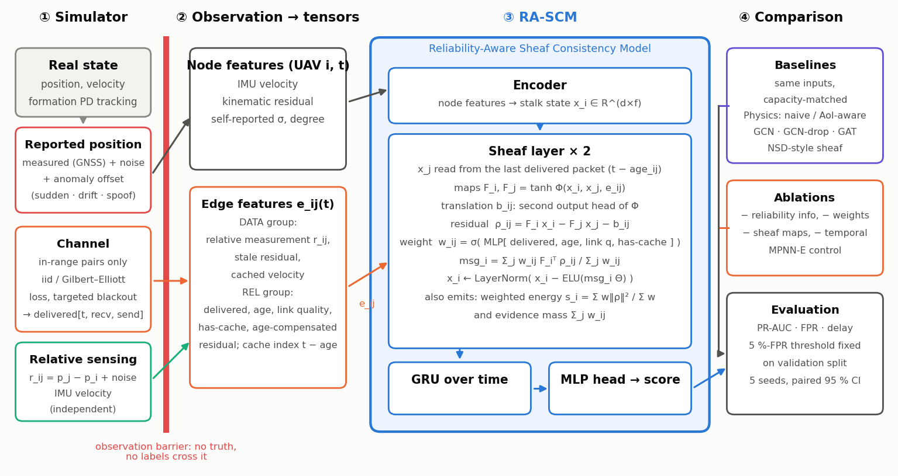
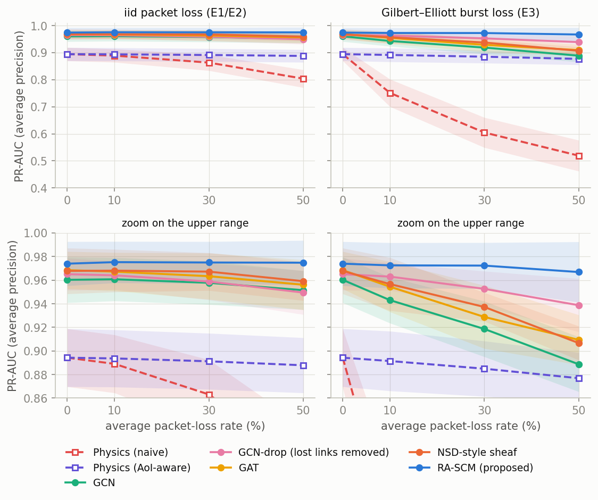
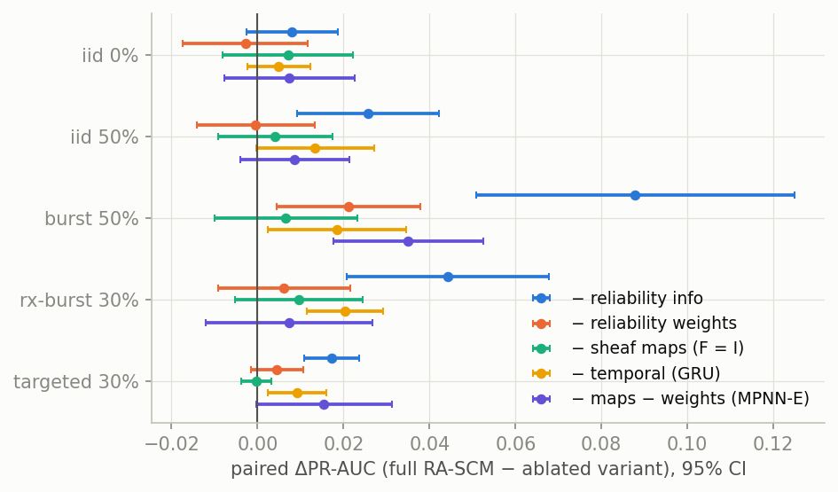
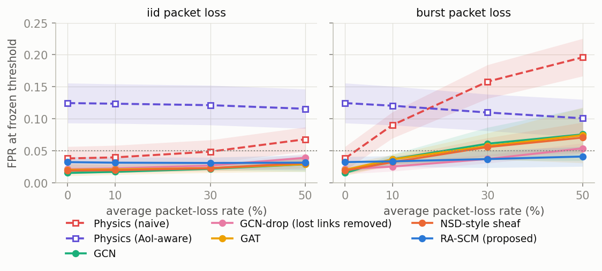
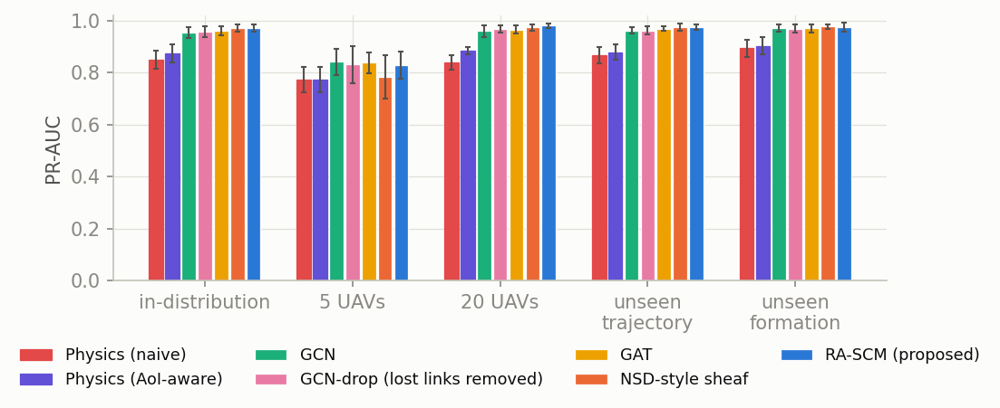
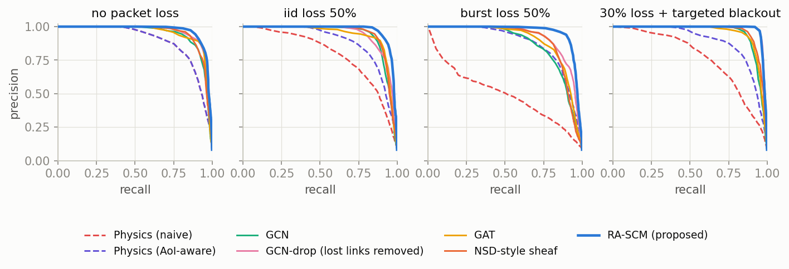
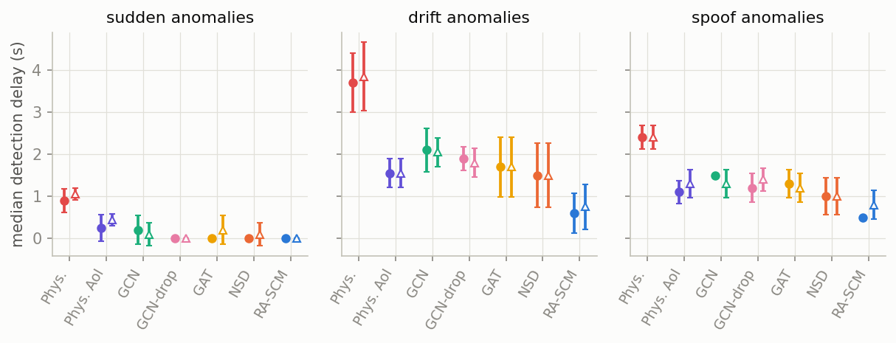
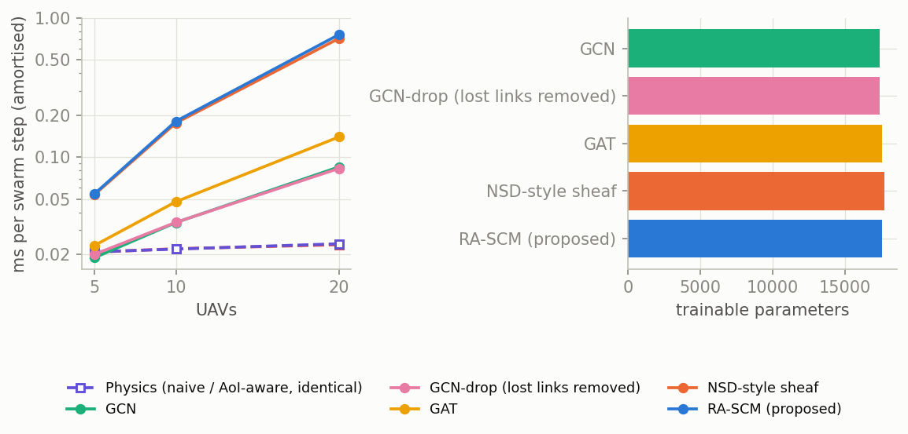

## 10. Researcher's reflection

**1. The Skeptic — "this research is unnecessary."** In our controlled simulation a consistency test that treats stale reports as current falls from {{m:physics_naive:iid_0:pr_auc}} to {{m:physics_naive:burst_50:pr_auc}} PR-AUC under bursty loss ({{m:physics_naive:nodeburst_30:pr_auc}} under rx-burst loss), and no detector we reviewed was tested with loss as a controlled confounder. The expert is partly right: an age-aware test restores most of the loss ({{m:physics_aoi:burst_50:pr_auc}}) and a plain GAT with the same inputs reaches {{m:gat:burst_50:pr_auc}}; the sheaf machinery is not what fixes the problem. What is necessary is the controlled evaluation, not the architecture.

**2. The Failure — "after a year the hypothesis is wrong."** By our own rule it already is, in its strong form. What remains: a reproducible benchmark with paired seeds and an age-aware control; the finding that the reliability channel carries the benefit ({{da:burst_50:rascm_no_rel}} when removed) while learned maps show none; the limit for small swarms (5 UAVs: {{m:rascm:gen_n5:pr_auc}}); the failure of frozen thresholds under noise shift; tested code and a dashboard.

**3. The Originality — "remove everything borrowed."** Sheaf Laplacians, NSD-style layers, GCN/GAT, uncertainty weighting, Gilbert–Elliott loss, AoI and consistency tests are borrowed. What is ours: (a) framing the task as *confounded evidence* (missing versus wrong) with explicit observability conditions; (b) applying delayed-message semantics [@tolstaya2020learning] uniformly to every architecture and extending them to lost packets, so comparisons cannot leak; (c) the protocol — loss as a controlled confounder, frozen operating point, paired seeds, age-aware physics control, component ablations; (d) the findings, including the negative ones. We do not claim a new algorithm.

**4. The Reality — €500, one computer, three months.** The minimum meaningful experiment is E3 (burst loss) with both physics tests, the four conventional GNNs and RA-SCM over five seeds; on the existing simulator it needs about 20 minutes of training per seed on one laptop (Table B2) at no hardware cost. From scratch: month 1 for literature, simulator and leakage tests; month 2 for logging loss traces (six ESP32 boards, ≈€60) and UWB/GNSS noise (≈€250) while building baselines; month 3 for fitting the channel and noise models, re-running E3 and writing. If RA-SCM's margin over the best conventional GNN stays below 0.02 on fitted parameters, the negative conclusion stands.

**5. The Intellectual Honesty — "strongest argument against."** A plain GAT with the same inputs comes within {{n:gat_gap}} PR-AUC of RA-SCM on $C^*$; a 20-line age-aware test removes most of the damage of stale reports (though it stays {{n:phys_gap}} below RA-SCM); learned maps add nothing measurable; and simulator, baselines and model share one source. We would change our minds if, on measured loss and noise, RA-SCM beat the best conventional GNN by ≥0.02 with an interval above 0 in at least four conditions *and* the identity-map ablation fell behind by ≥0.01 — or, conversely, if the age-aware test matched the learned models on real traces.

**Declaration of AI assistance (HW1 academic-integrity rules).** The project was carried out with Claude Sonnet 5.5 (Anthropic) in Claude Code (27–30 October 2026), which proposed and ran the searches, summarised the papers, wrote the simulator, model, test and analysis code, ran the experiments, produced the figures and drafted the text, including first drafts of the reflection. A pre-submission check with Claude Opus 5.5 (6 November 2026) re-verified every reference against its DOI or arXiv record (and the full text where details are discussed), extended the search, recomputed the result numbers and led to the corrections in this version. "We" refers to the author working with this assistant. All result numbers (Tables 3–5, B1–B2 and every PR-AUC, FPR, difference and count in Sections 9–10) are inserted automatically from result files; design parameters are copied from `configs/default.yaml`. The author chose the problem, directed the work, reviewed the final text and remains responsible for verifying every claim and citation.

## 11. References

::: {#refs}
:::

## Appendix A. Figures (optional visuals, not counted in the page limit)

{width=100%}

{width=86%}

{width=88%}

{width=70%}

{width=75%}

{width=80%}

{width=100%}

{width=85%}

{width=80%}

## Appendix B. Supplementary tables (optional, not counted in the page limit)

{{tbl:secondary}}

*Table B1. Frozen-threshold secondary metrics (means over seeds; delay over detected UAVs only).*

{{tbl:cost}}

*Table B2. Parameters, amortised CPU inference time and training time. RA-SCM costs far more compute than GCN/GAT for a modest accuracy gain.*
